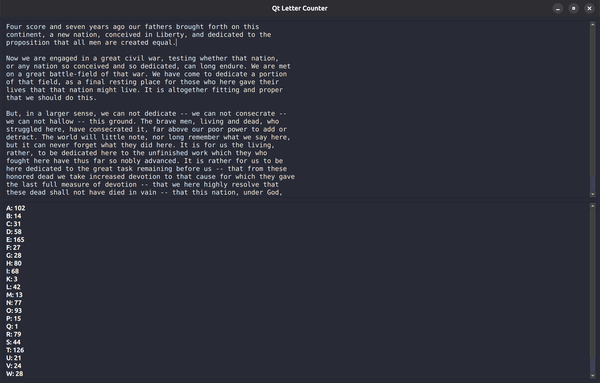

# Qt-Letter-Counter

This is a simple program for reading text and displaying how many letters show up in what the user entered. I wanted to learn how to make GUIs using the [Qt framework](https://www.qt.io/). As a result, this project was made using PySide6 to help me learn Qt.

## Requirements

In order to run this program on your system, you will have to set up a virtual environment for Python in the working directory, and install PySide6.

## Limitation

At the moment, the project only works with the English alphabet.

## Credits

I used some of the specfications provided by the [Dracula Color Theme](https://draculatheme.com/spec).
